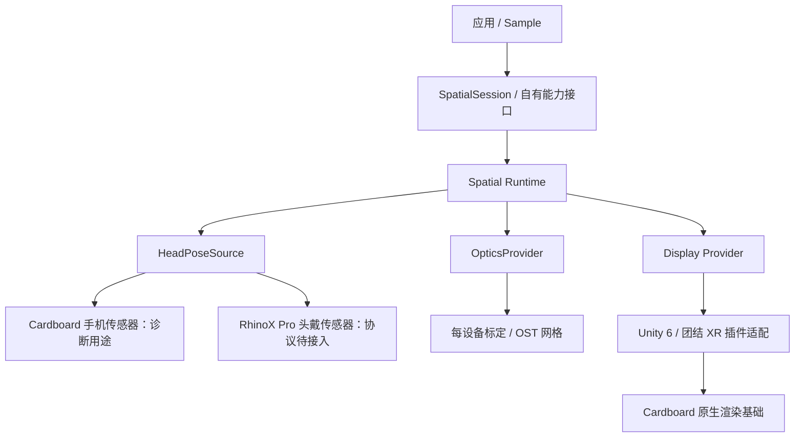

# Cardboard 接入：已完成基线与下一阶段实现约束

日期：2026-09-28。产品名称 Spatial AI SDK；当前 UPM 预览包为 0.2.0-preview.7。近期运行状态见 `docs/VALIDATION.md`。

iOS 使用同一个 Unity 包与 Cardboard XR 插件的 iOS Provider。手机插入式 Viewer 是首个 iOS 基线，消费工程提供 iOS XR Loader 配置和 Xcode 导出入口。外接 RhinoX 需另接 iOS 设备协议、头戴姿态、外屏显示与光学标定，不能直接复用手机屏幕的 Cardboard Viewer 参数。

## Unity XR 基线补充

已补全固定版本 Cardboard XR Plugin 的本地检出，建立独立的 `samples/unity/SpatialXR/` 消费工程。`SpatialAI.Cardboard` 条件编译适配层只观察 Cardboard XR Loader、触发输入和屏幕参数刷新；显示提交、头姿与默认 Viewer 畸变仍由 Cardboard 负责。`Hello Spatial XR` Sample 显示设备 ID 匹配结果和标定状态。RhinoX Pro 旧参考 Profile 缺少经验证的 OST 网格，未传给 Cardboard 或启用为正式光学配置。独立手柄与 SpatialSession 的硬件 Backend 仍未连接。

## 1. 当前交付

- 原生 SDK 与 Unity XR Plugin 均固定 v1.35.0 和完整 Git 提交号。
- 原生 SDK 的头部融合、畸变、GLES/Vulkan 和 Unity XR Provider 源码已编译为 Android arm64 动态库。
- 脚本可重复获取、校验版本、编译并生成二进制校验报告；源码未打补丁。
- 独立构建的原生库尚未连接 SpatialSession，不进入对外 UPM 包；Unity XR 消费工程独立引用固定版本上游包内的 Android AAR。

此阶段验收：源码版本正确、工作区干净、Android 链接成功、ELF 架构正确、关键导出存在。设备运行验收尚未完成。

## 2. 接入边界

图示为目标接入关系。当前 SpatialSession 实现仍是 Simulator 和显式 Unsupported 的硬件占位；Cardboard XR 基线走独立适配层。

### 头部跟踪

1. 手机未固定在头部时，手机 IMU 表示手机方向，不能作为眼镜头姿。手机跟踪只用于独立诊断；RhinoX Pro 必须接入其实际姿态或 IMU 数据源。
2. Cardboard 公共初始化依赖 JavaVM、Android Context 和 SDK Java 类。单独复制 `.so` 并调用 getPose 不构成正确集成。
3. Android Cardboard pose 的预测时间使用 CLOCK_BOOTTIME。由原生层统一生成与校准时间，不能直接传入进程启动后的 Stopwatch 相对时间。
4. 原版 Unity provider 的旋转转换是 `(x, y, -z, w)`，参见固定源码 `sdk/unity/xr_provider/math_tools.cc` 的 CardboardRotationToUnityPose。它与上游姿态语义一起使用，不能直接套用到 RhinoX Pro 协议。
5. V1 为 3DoF，不把 Cardboard 颈部模型生成的位移宣传成位置跟踪。
6. 公共 getPose 没有传感器有效/新鲜度标志。适配层必须另行获得传感器健康信息或引入受控补丁；不能将身份四元数自动视为已跟踪。断连、过期、暂停后清除状态，重新收到有效数据再恢复。

### 光学与显示

- RhinoX Pro 的旧参数仅作为参考；必须确认标定数据对应当前硬件、分辨率和输出方向。
- Cardboard 手机屏幕参数、二维码和通用透镜畸变不能直接替代眼镜的 OST 标定。
- 每眼投影/视口/眼位/畸变网格由自有 OpticsProvider 管理，畸变仅执行一次。
- 手机外接眼镜的显示路由、输出模式、刷新率和左右眼布局必须单独实现并验证。
- 保持图形线程提交与纹理所有权边界。GLES/Vulkan 编译通过并不证明 Unity 6、团结或外接屏可运行。

## 3. 下一阶段任务与验收

| 顺序 | 任务 | 完成标准 |
| --- | --- | --- |
| 1 | 完整官方 APK 基线 | 补齐 Java/资源/protobuf/Gradle 和样例；打包并在指定 Android 手机上运行，记录设备与版本 |
| 2 | Spatial 头姿诊断接入 | 原生初始化、生命周期、时间与坐标转换、传感器健康检查；暂停恢复和失效不会保留旧姿态 |
| 3 | RhinoX Pro 连接与头姿 | 实际设备连接/断开/恢复；手机静止时转动眼镜，姿态仍正确 |
| 4 | 双目与光学 | 双眼测试图、左右眼方向、投影、OST 网格和单次畸变验收 |
| 5 | 3DoF 手柄 | 指向、悬停和扳机反馈，断连状态可见 |
| 6 | 两引擎闭环 | Unity 6、团结各选定明确版本，从新建项目到 APK/眼镜运行分别验收 |

第一期手机兼容列表保持“待定”，RhinoX Pro 保持首个调试硬件。模型适配、Spatial Tools 与商业分发接口沿用总体设计，不加入此构建基线的依赖。

## 4. 构建产物限制

当前 NDK 23.1/API 26/arm64/GLES3+Vulkan 仅为本机编译配置。上游 Android 配置使用更新的 NDK 与 Java 17；完整 AAR 应按锁定后的 Android 工具链构建。当前没有 Unity 6/团结运行认证，没有手机白名单，也没有真实头部跟踪或双目显示的成功记录。
